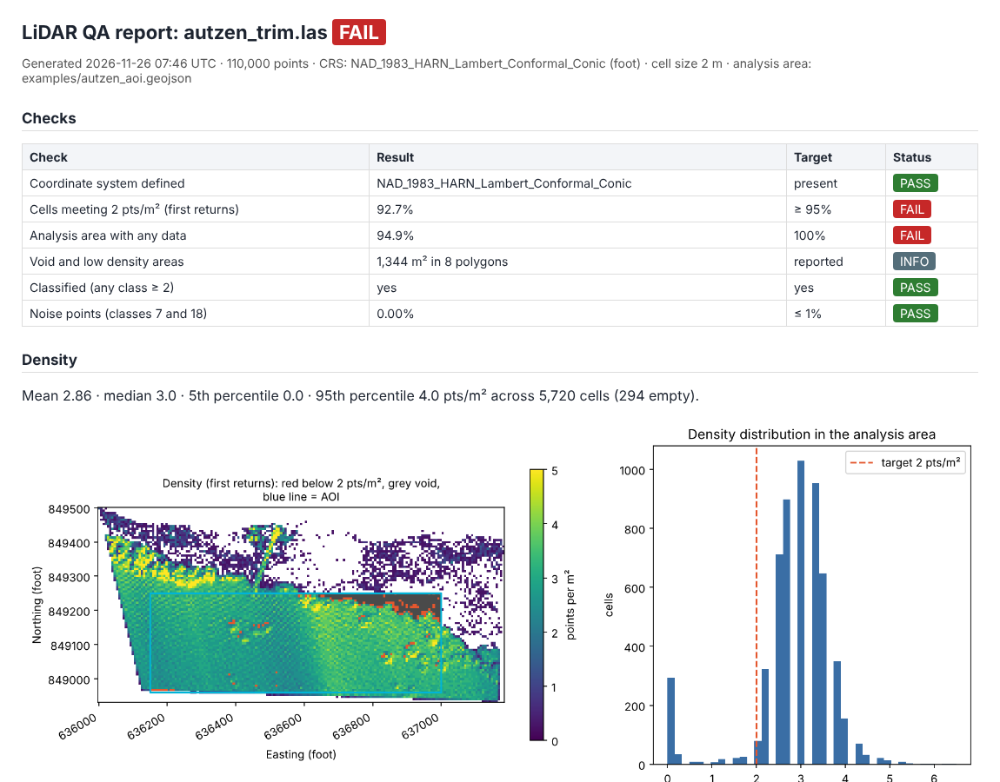

# LiDAR QA Toolkit

[](https://github.com/jjmmcckk/lidar-qa-toolkit/actions/workflows/tests.yml)

One command quality checks for LAS/LAZ point clouds, built for UAV LiDAR deliveries:
point density against a target, coverage of the planned survey area, void and low density
polygons, coordinate system, classification and noise. Results go to a one page HTML report
plus files that open directly in QGIS or ArcGIS Pro.



## Why

Before a LiDAR survey goes to a client, someone has to confirm it meets the acquisition
specification: enough points everywhere, full coverage of the planned area, a defined
coordinate system, classification, and acceptable noise. This tool runs those checks in one
pass and shows exactly where the data falls short.

## What it checks

| Check | How |
|---|---|
| Coordinate system | Read from the file (or set with `--crs`); horizontal units are detected, so feet based systems report density in points per m² |
| Point density | First returns (or all returns) binned into a grid in metres; share of cells meeting the target |
| Coverage | Share of the AOI with any data at all |
| Voids and low density areas | Polygons of empty cells and of cells below target, filtered by a minimum area |
| Classification | ASPRS class counts and shares; fails if nothing is classified beyond class 1 |
| Noise | Share of points in noise classes 7 and 18 |

For reference, the USGS 3D Elevation Program sets aggregate nominal pulse density of at least
2 points/m² for Quality Level 2 and 8 points/m² for Quality Level 1. This tool measures first
return density per grid cell, a practical field check rather than the formal USGS method.

## Install

```bash
pip install git+https://github.com/jjmmcckk/lidar-qa-toolkit
```

Python 3.10 or newer. Dependencies (laspy with LAZ support, rasterio, GeoPandas, shapely,
pyproj, SciPy, Matplotlib) install from PyPI.

## Use

```bash
lidar-qa flight.laz --aoi planned_block.geojson --min-density 8 --cell 1 --out qa/
```

| Option | Default | Meaning |
|---|---|---|
| `--aoi` | data footprint | Planned survey area in any format GeoPandas reads; reprojected to the cloud's CRS |
| `--cell` | 2 | Grid cell size in metres |
| `--min-density` | 2 | Target density in points per m² |
| `--pass-pct` | 95 | Percent of cells that must meet the target |
| `--returns` | first | Count `first` returns or `all` returns |
| `--min-gap` | 4 cells | Smallest void or low density polygon reported, in m² |
| `--max-noise` | 1 | Maximum percent of noise points |
| `--crs` | from file | Coordinate system for files without one, e.g. `EPSG:2958` |

The exit code is 0 when every check passes and 1 otherwise, so the tool can gate a
processing pipeline. From Python:

```python
from lidarqa import analyse, gap_polygons, run_checks, write_report

result = analyse("flight.laz", cell_m=1.0, aoi_path="planned_block.geojson")
gaps = gap_polygons(result, min_density=8, min_gap_m2=4)
checks = run_checks(result, min_density=8, pass_pct=95, max_noise_pct=1.0, gaps=gaps)
write_report(result, checks, gaps, min_density=8, out_dir="qa")
```

## Outputs

| File | Contents |
|---|---|
| `report.html` | Checks with pass or fail, density map with AOI outline, histogram, voids, returns, classes |
| `density.tif` | Points per m² as a GeoTIFF in the cloud's CRS |
| `gaps.geojson` | Void and low density polygons with area in m² (WGS 84) |
| `class_summary.csv` | ASPRS class counts and shares |
| `summary.json` | Everything above in machine readable form |

## Example

The [example report](examples/autzen_report/) was made from the Autzen sample in the
[PDAL project's test data](https://github.com/PDAL/PDAL/tree/master/test/data/las)
(110,000 points, Oregon Lambert coordinates in feet) against a planned survey block that
extends past the edge of the flown data:

```bash
bash examples/get_sample_data.sh
lidar-qa examples/data/autzen_trim.las --aoi examples/autzen_aoi.geojson --out examples/autzen_report
```

```
[PASS] Coordinate system defined: NAD_1983_HARN_Lambert_Conformal_Conic (target present)
[FAIL] Cells meeting 2 pts/m² (first returns): 92.7% (target ≥ 95%)
[FAIL] Analysis area with any data: 94.9% (target 100%)
[INFO] Void and low density areas: 1,344 m² in 8 polygons (target reported)
[PASS] Classified (any class ≥ 2): yes (target yes)
[PASS] Noise points (classes 7 and 18): 0.00% (target ≤ 1%)
```

The report finds a 1,172 m² void where the planned block runs past the data, plus small low
density patches inside it.

## How it works

- Streams the file in chunks with laspy, so large clouds do not need to fit in memory.
- Converts the cell size from metres into the file's horizontal units, so density is always
  reported per square metre.
- Reads the AOI with GeoPandas and reprojects it to the cloud's CRS. Without an AOI, the
  data footprint is used with internal holes filled, so voids inside the survey still count.
- Turns void and low density cells into polygons with rasterio and drops slivers below the
  minimum area.

## Tests

`pytest` runs on every push. The tests build synthetic clouds with a known density, a known
400 m² void, a coordinate system in feet, an AOI that extends past the data, and noise
classes, and check that the tool measures each one correctly.

```bash
pip install -e ".[test]"
pytest
```

## Author

Jordan McKenzie, Transport Canada Advanced RPAS Pilot and Flight Reviewer, B.Sc. Computer
Science. [LinkedIn](https://www.linkedin.com/in/jordan-mckenzie-gis)

MIT License.
